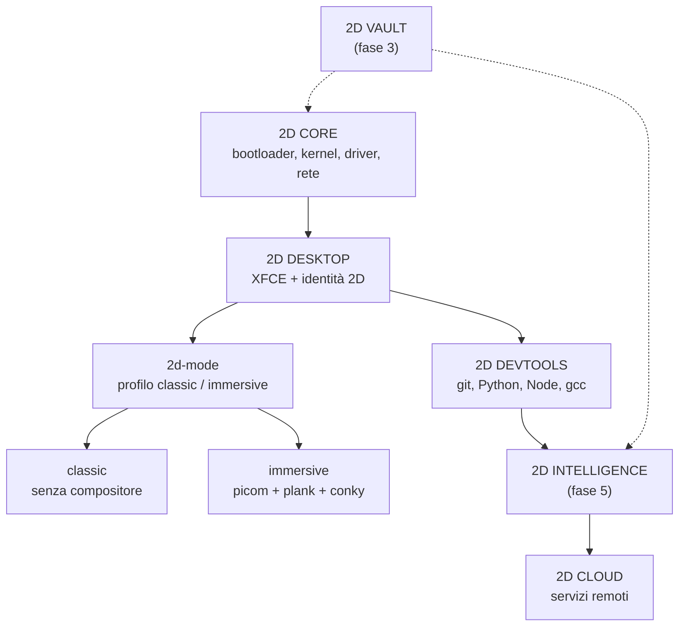

# 01 — Architettura

## Livelli



## Struttura dell'immagine

```text
USB
├── ISO 9660 (avvio, el-torito)
│   ├── /live/vmlinuz          kernel Debian
│   ├── /live/initrd.img       initramfs con Plymouth
│   └── /live/filesystem.squashfs  sistema compresso (xz)
└── partizione 2 (opzionale, etichetta "persistence")
    └── persistence.conf       "/ union"
```

- `squashfs` è in sola lettura: il sistema non si degrada con l'uso.
- Senza partizione `persistence` la sessione è effimera (come un live classico).
- Con `persistence` le modifiche vanno in un overlay sulla seconda partizione.

## Scelte tecniche e motivo

| Scelta | Perché |
|---|---|
| Debian 13 (trixie) | Base stabile, pacchetti aggiornati, `non-free-firmware` incluso |
| `live-build` | Strumento ufficiale Debian, configurazione versionabile in Git |
| XFCE | Funziona su 4 GB con grafica integrata; tema personalizzabile |
| zram invece dello swap su USB | Evita usura della chiavetta, latenza migliore |
| xz per squashfs | Migliore compressione: meno letture da USB 2.0 |
| `toram` non attivo | Con 4 GB di RAM toglierebbe memoria alle applicazioni |
| Plymouth "script" | Tema leggero, senza dipendenze da font |
| Autologin su `2d` | La USB è personale: meno attrito all'avvio |

## Cosa NON c'è (e perché)

- **Secure Boot**: la GRUB della ISO non è firmata. Sui PC del laboratorio il Secure Boot
  è assente o disattivabile.
- **Compiz / effetti 3D**: la GMA X4500 non regge il compositing accelerato.
- **AI locale**: un modello utile non entra in 4 GB. In fase 5 l'AI sarà cloud-first,
  con opzione locale solo su macchine con GPU.

## Punti di estensione

| Cosa | Dove |
|---|---|
| Pacchetti | `live/config/package-lists/*.list.chroot` |
| File di configurazione | `live/config/includes.chroot/` |
| Logica di build | `live/config/hooks/live/*.hook.chroot` |
| Identità visiva | `brand/` (copiato automaticamente nella build) |
| Pacchetti `.deb` esterni | `vendor/debs/` |
