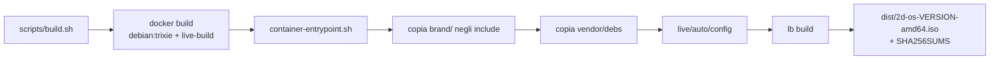

# 02 — Build

## Flusso



Tutta la build gira in un container: la macchina che costruisce non deve avere
`live-build` installato, e il risultato è riproducibile.

> **Perché non si costruisce direttamente nella cartella del progetto**
> Nei dev container (Codespaces) il volume `/workspaces` è montato `nodev`: i device
> node creati da `debootstrap` (`/dev/null`, `/dev/tty`) non sarebbero apribili e
> `dpkg` fallirebbe con `cannot create /dev/null: Permission denied`.
> Per questo `container-entrypoint.sh` copia il progetto in `/var/tmp/2dos-build`
> dentro il container, costruisce lì e riporta in `dist/` solo il risultato.

## Comandi

```bash
make build       # build completa
make clean       # rimuove chroot, binary e dist/
make assets      # rigenera ring.png e dot.png del tema di avvio
make version     # versione corrente
```

Per vedere il log completo:

```bash
tail -f live/build.log
```

## Tempi e spazio

| Fase | Tempo indicativo |
|---|---|
| `docker build` (solo la prima volta) | 1–3 min |
| Download pacchetti Debian | 5–15 min |
| Chroot + squashfs + ISO | 5–15 min |
| **Totale** | **15–30 min** |

Spazio necessario: ~8 GB durante la build, ~3 GB per l'ISO.

## Modificare la configurazione

### Aggiungere un pacchetto

Aggiungere una riga al file `.list.chroot` più adatto:

```text
# live/config/package-lists/2d-devtools.list.chroot
postgresql-client
```

Se il nome non esiste nel repository Debian la build si interrompe: verificarlo prima con

```bash
docker run --rm debian:trixie bash -c "apt-get update -qq && apt-cache policy NOME"
```

### Aggiungere un file al sistema

Creare il percorso corrispondente in `live/config/includes.chroot/`:

```text
live/config/includes.chroot/etc/skel/.config/xfce4/xfconf/xfce-perchannel-xml/xfce4-panel.xml
```

diventa `/etc/skel/.config/...` dentro il sistema.

### Aggiungere uno script di build

Nuovo file in `live/config/hooks/live/`, nome con prefisso numerico, **eseguibile**:

```bash
chmod +x live/config/hooks/live/0400-mio-hook.hook.chroot
```

Gli hook girano come root dentro il chroot, in ordine alfabetico.

### Installare VS Code

```bash
# scaricare il .deb ufficiale per amd64
cp code_*.deb vendor/debs/
make build
```

L'hook `0200-2d-extra-debs` lo installa e poi rimuove il file dall'immagine.

## Problemi noti

| Sintomo | Causa | Rimedio |
|---|---|---|
| `cannot create /dev/null: Permission denied` | chroot costruito su filesystem `nodev` | costruire in `/var/tmp` (già gestito) |
| `lb config: unrecognized option` | opzione rimossa nella versione 2025 di live-build | usare `--chroot-squashfs-compression-*` |
| `lb build` si ferma su un pacchetto | nome errato o non presente in trixie | rimuoverlo o correggerlo |
| ISO non parte in UEFI | Secure Boot attivo | disattivarlo nel firmware |
| Boot molto lento | USB 2.0 + hardware datato | atteso su Acer; usare una USB di qualità |
| Tema Plymouth non visibile | driver video senza KMS | comportamento noto su GMA X4500 |
| `Permission denied` dopo la build | file creati da root nel container | `sudo chown -R $USER:$USER dist` |
