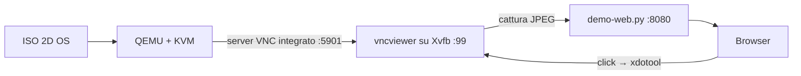

# 08 — Provare 2D OS nel browser

Due modi, entrambi senza toccare l'hardware.

## A. La ISO completa in una macchina virtuale

```bash
make build                                  # crea dist/2d-os-<versione>-amd64.iso
./scripts/demo-vm.sh dist/2d-os-0.1.0-amd64.iso 8080
```

Cosa succede:



- QEMU usa KVM (`/dev/kvm` deve esistere), 2 GB di RAM, 2 CPU.
- `-device usb-tablet` rende il puntatore assoluto: i click nel browser
  arrivano nella posizione esatta, non con spostamenti relativi.
- Il viewer VNC è a tutto schermo sul display virtuale: nessuna barra di menu,
  quindi la corrispondenza click↔pixel è 1:1.

URL: `http://localhost:8080/` (in Codespaces: la porta 8080 va inoltrata e
l'indirizzo diventa `https://<nome-codespace>-8080.app.github.dev`).

Per fermare tutto:

```bash
pkill -f qemu-system-x86_64; pkill -f vncviewer
pkill -f demo-web.py; pkill -f "Xvfb :99"
```

## B. Solo la shell desktop (sviluppo dell'interfaccia)

```bash
./scripts/demo-browser.sh          # avvia Xvfb, 2d-shell, x11vnc, noVNC
```

Utile per modificare la grafica: si ricarica la pagina e si vede subito il
risultato, senza aspettare il boot della VM.

## Note tecniche

| Problema | Causa | Soluzione |
|---|---|---|
| `localhost:8080` non si apre | ambiente remoto (Codespaces) | inoltrare la porta / usare l'URL del Codespace |
| QEMU lentissimo | KVM assente | serve `/dev/kvm`; in alternativa pazienza (TCG) |
| Click spostati | puntatore relativo | `-device usb-tablet` (già impostato) |
| Immagine nera | viewer non ancora agganciato | attendere 10–20 s dopo l'avvio |
| Boot lungo | prima volta, initramfs + systemd | fino a 90 s in VM |

## Differenza rispetto all'hardware reale

In VM non si testano: driver Wi-Fi, sospensione, ACPI del PC, velocità reale
della USB. Quelli restano i test del laboratorio (`docs/04-lab-test.md`).
